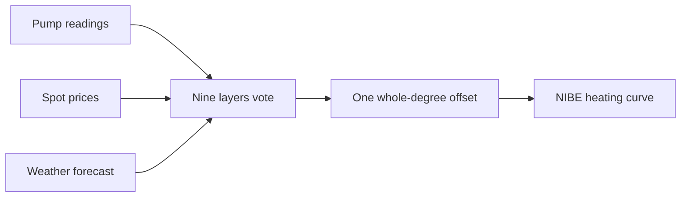

# EffektGuard


[](https://github.com/hacs/integration)


[](https://github.com/sponsors/enoch85)

[](https://my.home-assistant.io/redirect/marketplace_repository/?owner=enoch85&repository=EffektGuard&category=integration)
[](https://my.home-assistant.io/redirect/config_flow_start/?domain=effektguard)

NIBE heat pump control for Home Assistant. Every five minutes it nudges the pump's heating curve up
or down: more heat when electricity is cheap or a cold day is coming, less when it is expensive or a
new monthly power peak is near - with your comfort and the pump's health ahead of the savings. The
pump keeps all its own control; EffektGuard only moves the curve.

**Use at your own risk.** This software writes to a real heat pump. You are responsible for your
heating, your bill and your pump. Watch it closely the first weeks and turn it off if anything
looks wrong.

## Requirements

- Home Assistant 2025.11 or newer.
- A NIBE heat pump exposed as Home Assistant entities by one of:
  - [MyUplink](https://www.home-assistant.io/integrations/myuplink/) (cloud)
  - [nibe_heatpump](https://www.home-assistant.io/integrations/nibe_heatpump/) (local, NibeGW or
    Modbus TCP; most of its entities are disabled by default, enable the ones you need)
  - [Modbus](https://www.home-assistant.io/integrations/modbus/) sensors plus a template number
    for the offset register, see [Local Modbus](#local-modbus)
- A model profile: F730, F750, F1155, F2040 or S1155. Pick the nearest for another NIBE model.
- [GE-Spot](https://github.com/enoch85/ge-spot) for 15-minute spot prices. Without it there is no
  price optimization.
- Optional: a weather entity with an hourly forecast (Met.no works) for pre-heating before cold
  days, and a whole-house power meter for peak tracking (without one the pump's own phase currents
  are used when it exposes them). The meter's value counts until Home Assistant shows it
  unavailable, so a meter that can freeze should declare that (MQTT `expire_after`, a template's
  `availability`).

## Install

Use the two buttons above: the first opens EffektGuard in the Marketplace (Home Assistant 2026.11
and newer; download it), the second starts the setup. If EffektGuard is not in the catalog yet, the
first button offers to add it as a custom repository. On Home Assistant 2026.10 and older use
[HACS](https://hacs.xyz/): find EffektGuard under *Integrations* (or first add
`https://github.com/enoch85/EffektGuard` as an integration under *Custom repositories*), download it
and restart. Manual: copy `custom_components/effektguard/` into your config directory and restart.
Then *Settings, Devices & services, Add integration, EffektGuard*.

## Setup

The config flow asks, in this order:

1. **Offset entity**: the number entity for the heating-curve offset (register 47011 on the
   F-series, for example `number.heat_offset_s1_47011`).
2. **Price sensor**: a GE-Spot `current_price` sensor, and whether price optimization is on.
3. **Heat pump model**: default F750.
4. **Weather entity**, and whether peak protection is on.
5. **Sensors**: degree minutes, power meter, the temporary-lux switch (needed for hot-water
   control), extra room sensors, and override fields for setups discovery cannot name (generic
   Modbus, renamed entities).

Everything else is found by entity-name pattern. *Reconfigure* changes the entities later.
*Configure* holds the options: mode and tolerance ([Your settings](#your-settings)), thermal mass
and insulation (0.5-2.0), the hot-water target, amount and schedule, and airflow rates on the
F750/F730.

## What you get

- **Why it did what it did**: `sensor.effektguard_optimization_reasoning` - the state is a
  summary, the attributes hold each layer's offset, weight and reason
  ([SENSOR_STATE_LIMITS.md](docs/SENSOR_STATE_LIMITS.md)).
- `climate.effektguard`: HEAT or OFF (OFF holds the offset at 0 and runs no layer), the target
  temperature and the presets ([Your settings](#your-settings)).
- Sensors (`sensor.effektguard_current_offset`, `sensor.effektguard_degree_minutes`, ...): current
  offset, degree minutes, supply, outdoor and indoor temperature, current electricity price, peak
  today, peak this month, NIBE power, compressor frequency and health, optimization reasoning,
  quarter of day, price period classification, indoor and outdoor temperature trend, estimated
  monthly savings, heat pump model, DHW status, recommendation and scheduled start. The F750/F730
  also get airflow enhancement and thermal gain.
- Switches (`switch.effektguard_enable_optimization`, ...): enable optimization, price
  optimization, peak protection and weather prediction (on by default); hot water optimization and
  airflow optimization (off by default, the latter F750/F730 only).
- Services: `effektguard.force_offset` (offset -10 to +10 for 0-480 min, 0 = one cycle),
  `effektguard.boost_heating` (+10 for 30-360 min), `effektguard.boost_dhw` (temporary lux for
  30-180 min), `effektguard.reset_peak_tracking`, `effektguard.calculate_optimal_schedule`
  (returns a 24-hour price preview).

## How it decides

Every five minutes, ten seconds past the mark, EffektGuard reads the pump, the prices and the
forecast, and nine layers each vote for an offset with a weight:



| Layer | What it does | When it acts |
|---|---|---|
| **Safety** | Raises the curve to +10 | The room is below 18 °C |
| **Thermal debt** | Raises the curve so the pump catches up; past -1500 degree minutes it forbids any cut instead | Degree minutes (NIBE's heat-deficit counter) run deep |
| **Proactive** | Small raises before the debt gets deep | Degree minutes start to fall |
| **Peak** | Lowers the curve so the house does not set a new monthly power peak | Close to this month's peak; needs a power meter or the pump's phase currents |
| **Learned pre-heat** | Raises ahead of a predicted drop in room temperature | After 24 h of history, when it predicts a drop |
| **Weather compensation** | Nudges the curve toward the flow temperature your radiators or floor need at today's outdoor temperature | Always, with a small weight; pauses during hot water |
| **Weather pre-heat** | Raises +2 before a colder day | The forecast drops 4 °C or more within the look-ahead (longer for a concrete slab) |
| **Spot price** | Raises in cheap quarters, lowers in expensive ones, lets the house coast through price peaks | Whenever GE-Spot has prices; each quarter is ranked against its own day |
| **Comfort** | Pulls the room back toward the target | The room drifts out of its band |

**How the votes combine.** A vote at full weight wins: safety, a price-peak quarter, the monthly
peak, or a room far too warm. Otherwise the result is the weighted average. Price and peak may
soften a thermal-debt recovery but never reverse it, and may coast the house within its comfort band
but not out of it. The result reaches the pump as a whole degree, at most every five minutes; a
reversal of 2 °C or more within 45 minutes is held back.

The degree-minute thresholds come from Home Assistant's latitude and the outdoor temperature: the
same reading is normal in Kiruna at -30 °C and a warning in Malmö at 0 °C. Details:
[docs/architecture/](docs/architecture/00_overview.md).

## Your settings

- **Target temperature**: on the climate entity, 18.5-25 °C.
- **Tolerance** (0.5-3.0): how far the room may drift before the comfort layer acts, ±0.4 x the
  setting (1.2 lets it drift ±0.48 °C).
- **Mode**: *Comfort* (comfort counts 1.3x, price 0.7x), *Balanced* (both 1x) or *Savings* (comfort
  0.7x, price 1.3x, and a price-peak quarter always cuts fully). The climate presets map to them:
  none = Balanced, comfort = Comfort, eco = Savings, away = Savings with the target 3 °C lower.

## Safety

- Indoor below 18 °C: the safety layer asks +10 at full weight (+7.5 while the room is already
  warming fast).
- Degree minutes past -1500: no layer may cut below 0 unless the room is above its band, and
  nothing raises into the flat-out compressor.
- At most one write every 5 minutes, whole degrees only, clamped to -10..+10 and to the number
  entity's own range.
- A cycle that cannot read the pump writes nothing and the entities go unavailable.
- `force_offset` cannot hold the pump below these floors.

## Local Modbus

With the generic `modbus` integration, define sensors for the registers you need (temperatures and
degree minutes are raw x10, use `scale: 0.1`; the offset register is not scaled) and wrap the
offset register in a template number so EffektGuard can write it:

```yaml
template:
  - number:
      - name: "Heat Offset S1 47011"
        unique_id: nibe_heat_offset_s1_47011
        state: "{{ states('sensor.heat_offset_s1_47011') | float(0) }}"
        availability: "{{ has_value('sensor.heat_offset_s1_47011') }}"
        min: -10
        max: 10
        step: 1
        set_value:
          - action: modbus.write_register
            data:
              hub: nibe
              slave: 1
              address: 47011
              value: "{{ (value | int) % 65536 }}"
```

`min`, `max` and `step` are required: a template number defaults to 0-100, and EffektGuard clamps
to the entity's range, so a negative offset would never reach the pump. The displayed value catches
up on the sensor's next poll (`scan_interval`, 15 s default). Select this number in the first setup
step.

## Documentation

- [Architecture](docs/architecture/00_overview.md): the cycle, the layers, the aggregation
- [Climate zones](docs/CLIMATE_ZONES.md): the degree-minute tables per zone
- [Hot water](docs/DHW_OPTIMIZATION.md)
- [Development](docs/dev/README.md): setup, tests, code standards
- [Contributor rulebook](CLAUDE.md)

## License

MIT, see [LICENSE](LICENSE). Author: [@enoch85](https://github.com/enoch85).
