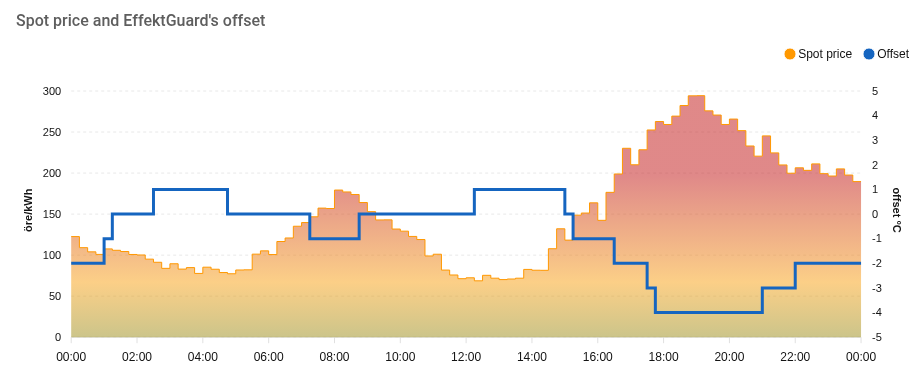
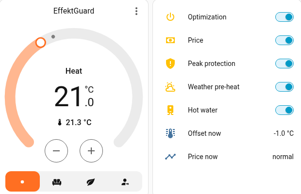
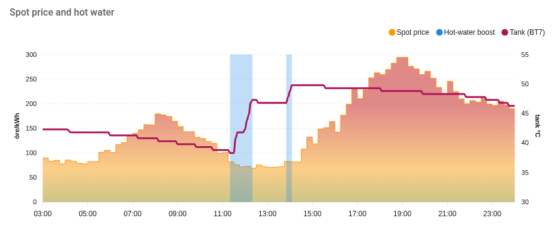

# EffektGuard

EffektGuard runs your heat pump on the electricity price. Your house is a heat battery: EffektGuard
charges it - raises the heat - when power is cheap, and lets it coast when power is expensive or a
new monthly power peak is near (the effect tariff). The house never gets cold. EffektGuard changes
one setting on the pump: the heating-curve offset.

It supports NIBE heat pumps today. Other brands can follow - want to add yours? See
[contributing](docs/dev/CONTRIBUTION_GUIDE.md).

> **Use at your own risk.** EffektGuard writes to a real heat pump. You are responsible for your
> heating, your bill and your pump. Watch it closely the first weeks, and turn it off if anything
> looks wrong.

*22 October 2026 on a real house (SE4 prices, EffektGuard v0.7.1): the offset mirrors the price - up
in the cheap night and midday hours to charge the house, down to -4 through the evening peak.*

## What it controls

| | What EffektGuard does | Default |
|---|---|---|
| Heating | Moves the heating-curve offset, -10 to +10 °C | On |
| Hot water | Switches the pump's hot-water boost (NIBE: temporary lux) at cheap times and before your hot-water times | Off |
| Ventilation | Boosts the ventilation when the extra exhaust-air heat is worth it (NIBE F750, F730) | Off |

Nothing else on the pump changes.

## Before you start

| You need | Without it |
|---|---|
| Home Assistant 2025.11 or newer | Not supported |
| Your heat pump in Home Assistant: today a NIBE, through [MyUplink](https://www.home-assistant.io/integrations/myuplink/), [nibe_heatpump](https://www.home-assistant.io/integrations/nibe_heatpump/) (enable its entities) or [Modbus](https://www.home-assistant.io/integrations/modbus/) ([how](docs/LOCAL_MODBUS.md)) | Nothing works |
| A model profile: NIBE F730, F750, F1155, F2040 or S1155 | Pick the nearest and [ask for yours](https://github.com/enoch85/EffektGuard/issues/new?labels=enhancement) |
| [GE-Spot](https://github.com/enoch85/ge-spot), the price source EffektGuard reads (it fetches from Nord Pool, ENTSO-E and others) | No price optimization |
| Optional: a weather entity with an hourly forecast | No pre-heating before a colder day |
| Optional: a whole-house power meter | Peak protection uses the pump's phase currents, if it has them |

**Turn off the pump's own price control first**, or the two fight each other. On a NIBE: *Smart
Control* in myUplink (`switch.<pump>_smart_control`).

## Install

1. **Marketplace** (Home Assistant 2026.11 and newer): the first button above. Download, restart.
2. **HACS** (2026.10 and older): the second button. If [HACS](https://hacs.xyz/) asks to add the
   repository, confirm. Download, restart.
3. **By hand**: copy `custom_components/effektguard/` into your configuration's `custom_components/`
   and restart.

Then add it: the third button, or *Settings → Devices & services → Add integration → EffektGuard*.

## Set up

The setup asks five things and finds the rest by entity name:

1. **Offset entity** - the heating-curve offset (NIBE F-series: register 47011, e.g.
   `number.heat_offset_s1_47011`).
2. **Price sensor** - GE-Spot's current price; price optimization on or off.
3. **Model** - F750 by default.
4. **Weather entity** (optional); peak protection on or off.
5. **Sensors** - degree minutes, the power meter, the hot-water boost switch (on nibe_heatpump an
   `input_boolean` helper for its select), extra room sensors and how to combine them, overrides.

*Reconfigure* changes these later; *Configure* holds the [settings](#settings).

## Daily use

The thermostat, `climate.effektguard`, is the day-to-day control:

| Choose | What happens |
|---|---|
| Target | The room temperature, 18.5-25 °C |
| HEAT, OFF | On, or paused: OFF holds the offset at 0 and EffektGuard decides nothing, safety included |
| Preset none, comfort, eco | Balanced, Comfort or Savings [mode](#settings) |
| Preset away | Savings, 3 °C below the target (never below 18.5 °C); the thermostat keeps showing your target, hot water is not changed. Choose your usual preset again when you are back |

Why it did what it did: `sensor.effektguard_optimization_reasoning`. After a start it watches a
cycle or two before it writes.

The charts in this README, live on your dashboard:
[dashboard-charts.yaml](docs/dashboard-charts.yaml) (needs
[apexcharts-card](https://github.com/RomRider/apexcharts-card)).

## Settings

Under *Configure*:

| Setting | Range (default) | Effect |
|---|---|---|
| Mode | Comfort, Balanced, Savings (Balanced) | Comfort reacts to a 0.1 °C drift and lets prices push less; Savings waits for 0.3 °C, lets prices push more and cuts fully at a price peak |
| Tolerance | 0.5-3.0 (0.5) | Comfort traded for price: a comfort band of ±0.4 × the setting, and price moves from 20 % (0.5) to 100 % (3.0) of full size |
| Thermal mass, insulation | 0.5-2.0 (1.0) | Your house: thermal mass 1.5 or more is a concrete slab, 1.2 or more timber floor heating |
| Hot water | Target 45-60 °C (50), amount 1-30 min (5), ready at 07:00 and 18:00 | See [Hot water](#hot-water) |
| Airflow | Standard 100-300, boosted 150-400 m³/h (150, 252) | NIBE F750 and F730 only |

Of the switches, Enable Optimization, Price Optimization, Peak Protection and Weather Prediction are
on by default; Hot Water Optimization and Airflow Optimization are off.

## How it decides

Every 5 minutes nine layers vote for an offset, and the votes become one whole-degree offset:

- **Price** - cheap quarters raise the curve to charge the house, more when an expensive spell is
  coming; expensive quarters lower it, more when a cheaper spell is coming; a price-peak quarter
  lowers it a lot.
- **Colder weather** - a colder day in the forecast raises the curve, earlier for a heavy house. The
  price vote decides where it lands: most in cheap quarters, none in a price-peak quarter.
- **Monthly peak** - near this month's power peak it lowers the curve. Needs peak protection, and a
  power meter or the pump's phase currents.
- **Thermal debt** - when the pump falls behind (degree minutes), it raises the curve while the room
  is below target or power is cheap. The limits adapt to your latitude, the outdoor temperature and
  your house.
- **Comfort** - it pulls the room back toward the target.

A full-weight vote wins: safety, a price-peak quarter, a new monthly peak about to be set, a room far
too warm. The rest are averaged. Price and peak cuts give way as the room drops below its comfort
band, and a reversal of 2 °C or more within 45 minutes is held back. [Safety](#safety) overrides it
all. Details: [architecture](docs/architecture/00_overview.md).

## Hot water

*The same day from 03:00, hot water: two boosts in the cheap midday hours (69-83 öre/kWh) heated
the tank from 38 to 50 °C; it coasted through the evening peak (up to 294 öre/kWh) and still held
46 °C at the end of the day.*

Off until you turn on `switch.effektguard_hot_water_optimization` and choose the boost switch in
setup. Then EffektGuard heats the tank at cheap times and has it ready for your hot-water times, each
boost running at least 15 minutes. The pump still heats a low tank on its own, and a boost you start
yourself is left alone. [More](docs/DHW_OPTIMIZATION.md).

## Safety

- Below 18 °C indoors: full heat (+10), and hot water stops. This needs a room reading.
- Past -1500 degree minutes: no cut below 0 unless the room is above its band, and hot water stops.
  The thermal-debt layer adds no raise there; raises from other layers pass, trimmed when the
  compressor is already at its maximum.
- Writes are whole degrees, -10 to +10 and within the offset entity's range; the automatic loop
  writes at most once every 5 minutes.
- A cycle that cannot read the pump writes nothing. `force_offset` cannot override these limits.

## Troubleshooting

| You see | Do |
|---|---|
| Heating changes you did not expect | Check that the pump's own price control is off ([Before you start](#before-you-start)) |
| Repair issue "No electricity price source" | Install GE-Spot and choose its sensor under *Reconfigure* |
| Repair issue "No hot-water control entity" | Choose the boost switch under *Reconfigure*. nibe_heatpump needs an `input_boolean` helper, and has none for the S-series |
| Entities unavailable | The pump could not be read (with MyUplink, its cloud may be slow or down). Nothing is written until it can be |
| The offset does not move | Check that the thermostat is on HEAT and read the reasoning sensor. A change under a whole degree is not written |
| Peaks look wrong | The power meter must go unavailable when it stops updating (MQTT `expire_after`, a template's `availability`) |
| Anything else | Download the diagnostics (*Settings → Devices & services → EffektGuard → ⋮*) and open an [issue](https://github.com/enoch85/EffektGuard/issues) |

## Reference

| Service | Does | Limits |
|---|---|---|
| `effektguard.force_offset` | Holds an offset | -10 to +10 °C for 0-480 min (0 = one cycle); once per 5 min |
| `effektguard.boost_heating` | Offset +10 | 30-360 min; once per 45 min |
| `effektguard.boost_dhw` | Hot-water boost | 30-180 min; once per 60 min; not under the [safety limits](#safety) |
| `effektguard.reset_peak_tracking` | Resets the monthly peaks, e.g. at a new billing period | |
| `effektguard.calculate_optimal_schedule` | Returns a 24-hour price preview | |

The first three need EffektGuard on, and act at once.

More: [architecture](docs/architecture/00_overview.md), [climate zones](docs/CLIMATE_ZONES.md),
[hot water](docs/DHW_OPTIMIZATION.md) and its [setup](docs/DHW_SETUP.md),
[local Modbus](docs/LOCAL_MODBUS.md), [development](docs/dev/README.md),
[contributor rulebook](CLAUDE.md).

## Support and license

[GitHub issues](https://github.com/enoch85/EffektGuard/issues) · MIT, see [LICENSE](LICENSE) ·
[@enoch85](https://github.com/enoch85)
