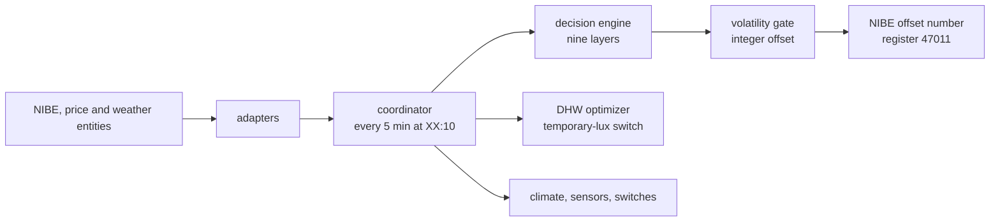

# Architecture overview

EffektGuard reads entities that other integrations publish (a NIBE heat pump, GE-Spot prices, a
weather forecast) and writes one thing: the heating-curve offset. It calls no external API. The
hot-water optimizer adds one switch (NIBE temporary lux), the airflow optimizer another (increased
ventilation, F750/F730 only).

## Data flow

## Modules

All paths under `custom_components/effektguard/`.

| Path | Role |
|---|---|
| `coordinator.py` | The 5-minute control loop; the only place that writes to the pump |
| `adapters/nibe_adapter.py`, `adapters/gespot_adapter.py`, `adapters/weather_adapter.py` | Read the NIBE, price and weather entities |
| `optimization/decision_engine.py` | Runs the nine layers and aggregates them into one offset |
| `optimization/thermal_layer.py` | `EmergencyLayer` (T1-T3, anti-windup, the EMERGENCY floor) and `ProactiveLayer` (Z1-Z5) |
| `optimization/climate_zones.py` | `ClimateZoneDetector`: degree-minute thresholds from latitude and outdoor temperature |
| `optimization/effect_layer.py` | `EffectManager`: monthly peaks and peak protection |
| `optimization/price_layer.py` | `PriceAnalyzer`: price classification and the spot-price vote |
| `optimization/weather_layer.py` | `WeatherCompensationLayer` (EN 442 emitter law) and `WeatherPredictionLayer` (pre-heat) |
| `optimization/prediction_layer.py`, `optimization/adaptive_learning.py`, `optimization/weather_learning.py` | Learned pre-heat, thermal-model learning, weather patterns |
| `optimization/comfort_layer.py` | `ComfortLayer`: the room against its band |
| `optimization/dhw_optimizer.py` | Hot-water scheduling through the temporary-lux switch |
| `optimization/airflow_optimizer.py` | Exhaust-air ventilation (F750/F730) |
| `utils/offset.py`, `utils/volatile_helpers.py` | The integer the register receives; the volatility gate |
| `models/` | Heat pump profiles: F730, F750, F1155, F2040, S1155 |
| `climate.py`, `sensor.py`, `switch.py`, `services.yaml` | The Home Assistant entities and services |
| `const.py` | Every numeric value |

## How the pieces are wired

- `__init__.py` builds the adapters, a `PriceAnalyzer`, an `EffectManager`, a `ThermalModel` from
  the thermal-mass and insulation options, and the `DecisionEngine`, which creates its own layers.
- The coordinator creates the learning objects (`ThermalStatePredictor`, `AdaptiveThermalModel`,
  `WeatherPatternLearner`); after that the engine's `thermal` is the `AdaptiveThermalModel`.
- The DHW scheduler receives the engine's `emergency_layer` and `price`, so hot water is blocked
  by the same degree-minute thresholds (`should_block_dhw`: T2 or worse, or past -1500).
- Options are hot-reloaded (`async_update_config`); changing an entity goes through
  *Reconfigure*, which reloads the entry.

## Facts worth knowing

- Nothing is a fixed threshold: `ClimateZoneDetector` derives the degree-minute band from Home
  Assistant's latitude and the current outdoor temperature, and `thermal_layer.py` tightens it for
  slow emitters (concrete x1.3, timber x1.15, radiators x1.0). Tables in
  [docs/CLIMATE_ZONES.md](../CLIMATE_ZONES.md).
- The ladder is Z1 to Z5, then T1 to T3, then EMERGENCY at DM -1500, where nothing cuts and
  nothing raises. There is no WARNING or CAUTION tier.
- A layer at weight 1.0 wins outright; otherwise the weighted average, with the thermal-debt
  special cases in [08](08_layer_priority_system.md).
- Learning observes hourly into a 28-day window; the learned pre-heat layer votes (weight 0.65)
  once the predictor holds 24 hours of history.
- Airflow optimization exists for the F750/F730 only and is off by default; see
  [11](11_airflow_optimization.md).

## The documents

- [01_normal_optimization_cycle.md](01_normal_optimization_cycle.md): the 5-minute cycle
- [02_emergency_thermal_debt.md](02_emergency_thermal_debt.md): the degree-minute ladder
- [03_effect_tariff_protection.md](03_effect_tariff_protection.md): monthly peaks
- [04_weather_preheating.md](04_weather_preheating.md): pre-heating before a colder day
- [05_spot_price_optimization.md](05_spot_price_optimization.md): price classification
- [06_learning_integration.md](06_learning_integration.md): learning
- [07_manual_override_services.md](07_manual_override_services.md): services
- [08_layer_priority_system.md](08_layer_priority_system.md): aggregation
- [10_adaptive_climate_zones.md](10_adaptive_climate_zones.md): climate zones
- [11_airflow_optimization.md](11_airflow_optimization.md): exhaust-air ventilation
