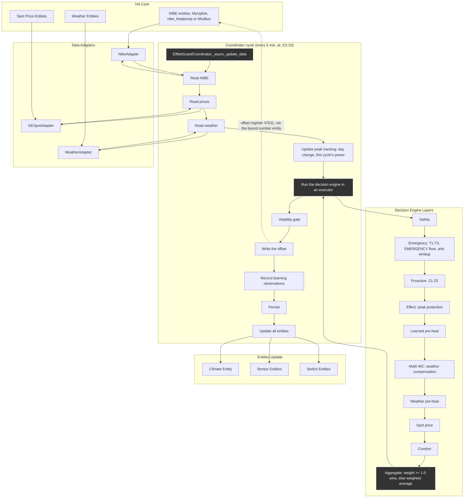

# Scenario 1: Normal Optimization Cycle

**Description**: The control cycle the coordinator runs every 5 minutes, clock-aligned at `:XX:10`
(Home Assistant's own scheduling is disabled), with all systems operating normally.

## Flow Description

### 1. Data Collection (every 5 minutes)
The coordinator reads, in this order:
- **NIBE**: heat pump state, temperatures, degree minutes (MyUplink, nibe_heatpump or Modbus entities)
- **Spot price**: native 15-minute prices (96 quarters a day)
- **Weather**: the forecast, for pre-heating and unusual-weather detection

It then updates the peak tracking - the day change and this cycle's power - **before** the
decision, so the effect layer judges the billing period on the power of the cycle it decides.

### 2. Decision Engine Execution
The decision engine runs nine layers, each returning `(offset, weight, reason)`:
1. **Safety**: below the 18 °C floor (`MIN_TEMP_LIMIT`) maximum heat
2. **Emergency**: thermal debt T1-T3, the EMERGENCY floor past the aux limit, anti-windup
3. **Proactive**: early degree-minute prevention, Z1-Z5
4. **Effect**: 15-minute effect-tariff peak protection
5. **Learned pre-heat**: the prediction layer
6. **Math WC**: weather compensation by the EN 442 emitter law
7. **Weather pre-heat**: before a colder day
8. **Spot price**: the 15-minute price classification
9. **Comfort**: the room against its band

### 3. Decision Aggregation
- A layer with weight ≥ 1.0 wins outright; otherwise a weighted average
  (see [08_layer_priority_system.md](08_layer_priority_system.md))
- The volatility gate (`utils/volatile_helpers.py`) may keep the previous offset, and
  `utils/offset.py` turns the decision into the integer the register takes
- The offset is written through the bound NIBE offset entity
  (MyUplink, nibe_heatpump, or a template number wrapping modbus.write_register)

### 4. Learning and State
- Learning observations are recorded hourly (`LEARNING_OBSERVATION_INTERVAL_MINUTES`), not every cycle
- Peak tracking, savings and learned data are persisted
- All entities are updated with the decision, its reasoning, peak tracking and diagnostics

A cycle that cannot read the pump writes nothing: the entities go unavailable and the next cycle
tries again.
