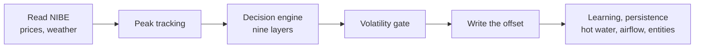

# The control cycle

`EffektGuardCoordinator` runs every 5 minutes, 10 seconds past the mark (`:00:10`, `:05:10`, ...),
on its own timer. Home Assistant's coordinator scheduling is off (`update_interval=None`), so the
reads land just after each 15-minute price boundary. One cycle:

## Reads

- **NIBE** (`NibeAdapter.get_current_state`): required. At start-up the coordinator waits up to 12
  cycles (`STARTUP_MAX_GRACE_ATTEMPTS`) for the entities to appear. After the first success a
  failed read runs the cycle once more 70 s later (`HEAT_PUMP_READ_RETRY_SECONDS`), after
  MyUplink's next poll. If that read fails too, the entities go unavailable, nothing is written,
  and the next cycle tries again.
- **Prices** (`GESpotAdapter.get_prices`): GE-Spot's `today_interval_prices` and
  `tomorrow_interval_prices`. Missing prices mean the price layer abstains and a repair issue is
  raised; nothing is invented.
- **Weather** (`WeatherAdapter.get_forecast`): the hourly forecast. Missing weather stands the
  pre-heat layer down; weather compensation runs on the pump's own sensors.
- **Peak tracking** (`_update_peak_tracking`) runs before the decision: power from the external
  meter, else the pump's phase currents, else an estimate that is shown but never recorded. The
  effect layer is given the 15-minute period mean this cycle projects to, not the instant.

## Decision

`DecisionEngine.calculate_decision` runs in an executor. The layers, in order, each return
`(offset, weight, reason)`: safety, thermal debt (`EmergencyLayer`), proactive (`ProactiveLayer`),
effect tariff, learned pre-heat, weather compensation ("Math WC"), weather pre-heat, spot price,
comfort. `_aggregate_layers` turns them into one offset ([08](08_layer_priority_system.md)); a trend
step then damps it (x0.75 when heating into a room warming 0.3 °C/h or faster, x1.15 when heating
below +3 into a room cooling that fast), `_limit_for_compressor_wear` caps a raise the saturated
compressor cannot follow, and `_limit_for_heater` keeps the degree minutes of a room at or above its
floor off the pump's immersion heater. Where the pump has been seen short of capacity and it is, or
within 12 forecast hours will be, as cold (`CapacityShortfall`), the guard stands down and nothing
goes below 0.

With the master switch off the decision is offset 0 and no layer runs. A manual override
(`force_offset`, `boost_heating`) replaces the layers, floored by `_absolute_safety_floor`.

## Start-up

A 120-second lockout (`STARTUP_GRACE_MIN_INTERVAL`), then one observation cycle
(`STARTUP_GRACE_UPDATES`), before the first write. An explicit service command bypasses both.

## Write

- **Volatility gate** (`OffsetVolatilityTracker`): a change of 2 °C or more that reverses direction
  within 45 minutes keeps the previous offset. Manual overrides, OFF, emergencies (the 18 °C floor
  or DM past -1500), anti-windup, a withdrawn raise on a saturated compressor and a heater guard
  cut bypass it.
- **The integer** (`utils/offset.py`): only the whole degrees of the pending demand (asked minus
  the register) are written, truncated, clamped to -10..+10 and to the number entity's own range.
- **The write** (`NibeAdapter.set_curve_offset`): `number.set_value` on the configured offset
  entity, at most once every 5 minutes (`SERVICE_RATE_LIMIT_MINUTES`) unless forced. An unchanged
  integer is not rewritten.
- **The other two actuators** have their own limits: increased ventilation
  ([11](11_airflow_optimization.md)) and the hot-water temporary lux
  ([DHW_OPTIMIZATION.md](../DHW_OPTIMIZATION.md)). Nothing else is written; EffektGuard calls no
  external API.

## After the write

- Learning: the thermal predictor records every cycle; the `AdaptiveThermalModel` once an hour
  (`LEARNING_OBSERVATION_INTERVAL_MINUTES`); the weather pattern once a day.
- Persistence: the effect peaks every cycle, learned data at most hourly.
- Hot-water control runs when its switch is on, airflow control when its switch is on
  (F750/F730); both are skipped during start-up observation and on read-only refreshes.
- The returned data updates the climate entity, the sensors and the switches.

A read-only refresh (a reload, an options change, a bookkeeping service) runs the same reads and
decision but writes nothing.
