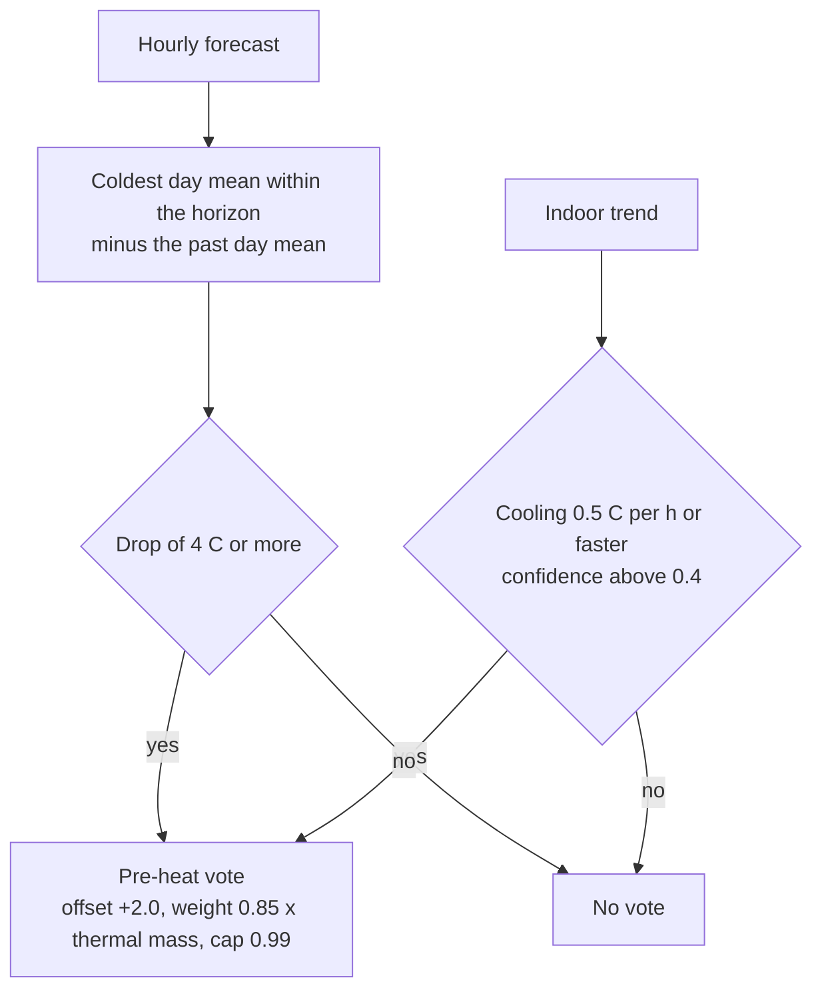

# Weather pre-heating

`WeatherPredictionLayer` in `optimization/weather_layer.py` decides **whether** to pre-heat before a
colder day. The amount is a constant.

## The algorithm

- A cold snap is a colder **day**: the layer compares 24-hour means
  (`WEATHER_DAILY_MEAN_HOURS`), so a cold night cannot fire it.
- The past day is the measured outdoor mean once the predictor's readings cover the last 24 hours
  with no gap over an hour (`DecisionEngine._outdoor_mean_past_day`); until then the next 24
  forecast hours stand in.
- The coldest day ahead is the lowest 24-hour mean starting within the horizon. A day the forecast
  covers only partly (at least 12 hours, `WEATHER_PARTIAL_DAY_MIN_HOURS`) is estimated from the day
  before it, shifted by how much the covered hours differ from the same clock hours a day earlier.
- The horizon is the thermal model's prediction horizon, floored at 12 hours
  (`WEATHER_FORECAST_HORIZON`): 12 h for radiators and timber floors, 48 h for a concrete slab
  (`UFH_*_PREDICTION_HORIZON`; thermal mass 1.5 or more is concrete, 1.2 or more timber). A slab
  gets into debt from a slow slide that a 12-hour window cannot see.
- Two triggers, either fires: a drop of 4 °C or more (`WEATHER_FORECAST_DROP_THRESHOLD`), or the
  room already cooling 0.5 °C/h or faster (`WEATHER_INDOOR_COOLING_CONFIRMATION`) with trend
  confidence above 0.4.
- The vote is `WEATHER_GENTLE_OFFSET` (+2.0) at weight `LAYER_WEIGHT_WEATHER_PREDICTION` (0.85)
  times the thermal mass, capped at `WEATHER_WEIGHT_CAP` (0.99) so it stays below safety.

No forecast, or the Weather Prediction switch off: no vote.

## Bounds

- The comfort layer's overshoot ramp reaches weight 1.0 at +1.5 °C over target
  (`OVERSHOOT_PROTECTION_FULL`) and wins outright, so the pre-heat cannot cook the house.
- A PEAK price quarter or the effect layer at the monthly peak also votes at 1.0 and outranks it;
  T1-T3 recovery is aggregated with it by weight ([08](08_layer_priority_system.md)).

Weather compensation ("Math WC", `WeatherCompensationLayer` in the same module) is a different
layer: it sets the flow temperature from the pump's own outdoor and supply sensors by the EN 442
emitter law and uses the forecast only to detect unusual weather. See
[docs/research/02_emitter_law.md](../research/02_emitter_law.md).
