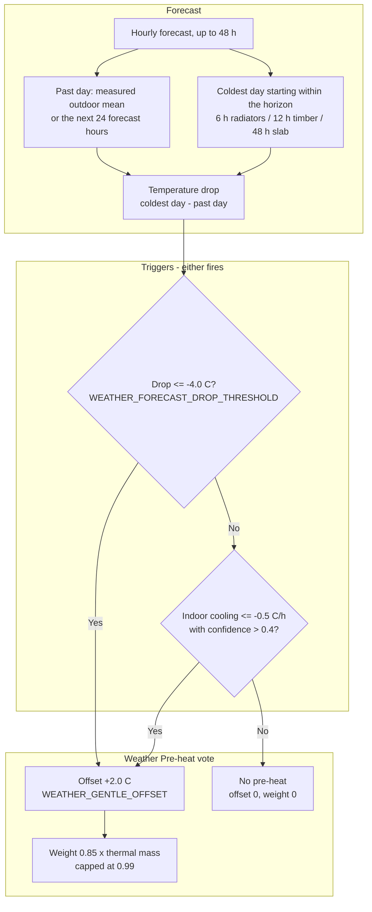

# Scenario 4: Weather-Based Pre-heating

**Description**: Pre-heating before a colder day: the layer decides **whether** to pre-heat; the amount
is a constant.



## Weather-Based Predictive Strategy

### The Actual Algorithm

> ⚠️ **This section used to describe a thermal-decay model that does not exist.** It documented a
> `heat_loss_rate`, an `expected_temp_end`, a `deficit`, a `1.0 / thermal_mass` safety margin, a
> `-2.0 × thermal_mass` dynamic threshold and a +3.0 °C cap. **Not one of those variables is in
> `weather_layer.py`.** Its worked example concluded "+3.0 °C", overstating the layer's authority
> by 3.6× against the +0.83 the code actually emitted at the time. What follows is the code.

`WeatherPredictionLayer.evaluate_layer()` is deliberately simple: it decides **whether** to
pre-heat, not **how much**. The amount is a constant.

```python
# 1. A cold snap is a colder DAY: compare 24-hour means, so a night's low cannot fire it. The
#    past day is the measured outdoor mean once the predictor's readings cover the last 24 h with
#    no hour unread (a restored history can be days old); until then the next 24 forecast hours
#    stand in for it.
temps = [f.temperature for f in weather_data.forecast_hours]
past_day = measured_past_day if it is known else mean(temps[:24])

# 2. The coldest day that starts within the horizon this building's thermal mass justifies:
#    6 h radiators / 12 h timber UFH / 48 h concrete slab, floored at WEATHER_FORECAST_HORIZON.
#    Met.no and OpenWeatherMap give 48 forecast hours, so a whole day fits only up to 24 h ahead.
#    A day the forecast covers at least WEATHER_PARTIAL_DAY_MIN_HOURS of is the day before it,
#    moved by how much colder its covered hours are than the same clock hours a day earlier: the
#    slab sees a colder day 36 h ahead, and the day-night swing still cancels.
def day_mean(s):
    if s + 24 <= len(temps):
        return mean(temps[s:s + 24])
    if s < 24:
        return None                       # the day before it is not in the forecast: skipped
    covered = range(s, len(temps))
    return mean(temps[s - 24:s]) + mean(temps[h] - temps[h - 24] for h in covered)

last = min(horizon, len(temps) - WEATHER_PARTIAL_DAY_MIN_HOURS)
temp_drop = min(day_mean(s) for s in (0 if measured else 1)..last) - past_day

# 3. Two independent triggers - either fires the layer.
forecast_triggered = temp_drop <= WEATHER_FORECAST_DROP_THRESHOLD      # -4.0 °C
indoor_cooling = (trend_rate <= WEATHER_INDOOR_COOLING_CONFIRMATION    # -0.5 °C/h
                  and trend_confidence > 0.4)

if forecast_triggered or indoor_cooling:
    return WeatherLayerDecision(
        offset=WEATHER_GENTLE_OFFSET,                                   # +2.0 °C, a constant
        weight=min(LAYER_WEIGHT_WEATHER_PREDICTION * thermal_mass, WEATHER_WEIGHT_CAP),
    )
```

**The horizon must follow the thermal mass, and this is not cosmetic.** A concrete slab does not
get into thermal debt from a sudden plunge — the pump's own curve is reactive but fast, and
catches that. It gets into debt from a slow, deep slide, and a fixed 12-hour window cannot see one:

| cold snap | drop within 12 h | fires? | drop within 24 h | fires? |
|---|---|---|---|---|
| 15 °C over 6 h (plunge) | −15.0 °C | yes | −15.0 °C | yes |
| 15 °C over 48 h (two days) | **−3.8 °C** | **NO** | −7.5 °C | yes |
| 20 °C over 72 h (three days) | **−3.3 °C** | **NO** | −6.7 °C | yes |

Within any twelve hours of a two-day slide the temperature falls less than the four degrees needed
to trigger, so the pre-heat **never fired** — while the sudden plunge, which *did* trigger it, is
the case that needed it least. See audit F-130.

### Safety Mechanisms

#### The pre-heat is bounded by construction
`WEATHER_GENTLE_OFFSET` is **+2.0 °C**, and it is sized, not tuned: the fabric must bank 1.0 °C
**within the horizon the house is given**, or the pre-heat is decoration. On the simulator's
validated plant models the previous +0.83 took **28.4 h** (radiator) and **34.6 h** (concrete slab)
to bank that 1.0 °C, against horizons of 12 h and 24 h. It could never charge the battery before the
cold arrived. At +2.0 it takes 9.6 h and 14.8 h — both inside. See audit F-130.

It cannot cook the house: the comfort layer's overshoot ramp wins outright at
`OVERSHOOT_PROTECTION_FULL` (+1.5 °C), whatever the prices, and +2.0 sits within
`WEATHER_COMP_MAX_OFFSET` (3.0), the bound placed on every weather-driven correction.

#### Weight scales with thermal mass
```
weight = min(LAYER_WEIGHT_WEATHER_PREDICTION × thermal_mass, WEATHER_WEIGHT_CAP)
```
A heavy building both needs more warning and can store more, so its pre-heat vote carries further.
The cap keeps it below the Safety layer.

This reflects their ability to store and retain heat effectively.

### Integration with Other Layers

The weather pre-heat vote (weight 0.85 × thermal mass, capped at 0.99) is aggregated with the others
(`docs/architecture/08_layer_priority_system.md`):

- **Price Layer (0.8, 1.0 at PEAK)**: a PEAK quarter outranks the pre-heat
- **Effect Layer (up to 1.0)**: protects the monthly peak
- **Emergency Layer (T1-T3 0.65 / 0.81 / 0.91)**: thermal-debt recovery acts by tier
