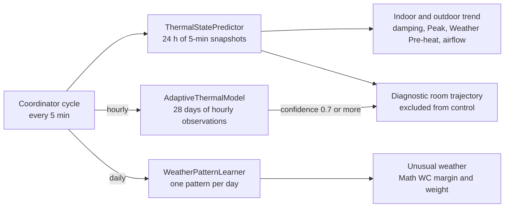

# Learning

Three learners record data on every control cycle. Little of what they learn steers the pump, and
what does is listed here. Learned pre-heating is inactive until the indoor trajectory is validated.

## The three learners

| Learner | Records | Produces | Reaches control |
|---|---|---|---|
| `AdaptiveThermalModel` (`adaptive_learning.py`) | indoor, outdoor and offset once an hour (`LEARNING_OBSERVATION_INTERVAL_MINUTES`), only with a measured room; rolling 672 = 28 days | thermal mass 0.5-2.0, response type, heat-loss index, heating efficiency, decay rate, confidence | diagnostic trajectory only; no heating vote |
| `ThermalStatePredictor` (`prediction_layer.py`) | indoor, outdoor, offset, flow, DM every cycle, and whether the room was measured; 24 h window | indoor trend from measured rooms only, outdoor trend; the `Learned Pre-heat` layer | trend: trend damping, the `Peak` layer's prediction, `Weather Pre-heat`, airflow. Pre-heat: excluded from aggregation while the trajectory is unvalidated |
| `WeatherPatternLearner` (`weather_learning.py`) | one pattern per day from the first 24 forecast hours, keyed by month and week | typical weather for the date (the zone's seasonal defaults until data exists); `detect_unusual_weather` | unusual weather adds 0.5-1.5 °C to the `Math WC` safety margin and 0.15 to its weight ([10](10_adaptive_climate_zones.md)) |

The predictor requires real elapsed coverage as well as enough samples. A full day needs both
endpoints; repeated timestamps replace the same observation, and older arrivals are ignored.
Trends and diagnostic forecasts use only the continuous, recently reported suffix. Future timestamps,
stale restores and gaps longer than `PREDICTION_MAX_SAMPLE_GAP_MINUTES` make it unusable.
Elapsed time is counted on the absolute timeline across clock changes.

## Why the room trajectory cannot request heat

The trajectory omits heat from the pump's native curve: offset zero still heats a real house,
but its equation subtracts heat loss without that input. A stationary measured room can therefore
produce a positive pre-heating proposal. History coverage and parameter consistency do not measure
forecast accuracy. The decision engine assigns this layer zero weight, including with a full,
fresh history and high learning confidence. The forecast API remains diagnostic.

An offline replay of the owner's October 27–November 6, 2026 export had 123 eligible hourly
origins, using only past room observations and supplying recorded future outdoor temperatures
and held offsets. The fallback six-hour mean absolute error was 1.780 C; holding the current room
gave 0.486 C. At twelve hours the errors were 4.010 and 0.663 C. Reconstructing adaptive parameters
from past hourly observations gave confidence 0.174–0.333, so the same fallback was used. These
conditional predictions do not prove control savings, nor performance at higher learned confidence.
The experiment scripts and detailed output accompany the review; no private history is committed.

Re-enabling this vote requires a model of native heating and forecast validation on data not used
to select it, against a persistence reference. A control benefit also needs comparable comfort and
initial/final thermal storage. The observed indoor/outdoor trends, weather compensation, weather
pre-heating, price, peak, thermal-debt and safety responses continue to operate.

## The confidence gate

`LEARNING_CONFIDENCE_THRESHOLD` = 0.7. `ThermalStatePredictor.predict_temperature` uses the
learned heating efficiency and decay rate only when the learned parameters carry that confidence;
below it, its own responsiveness estimate. Confidence (`_calculate_confidence`) is
0.4 × observations/672 + 0.4 × consistency of the heating rates + 0.2 × time span/7 days, and the
consistency term is 0 with ten or fewer heating samples or a mean rate under 0.1 °C/h.

Learning needs 96 hourly observations (`LEARNING_MIN_OBSERVATIONS`, 4 days) before it produces
anything, and 192 with offset steps above 1 °C before it classifies the response type.

## The look-ahead follows the owner's settings

`__init__.py` hands the engine the `AdaptiveThermalModel` as its thermal model, set to the owner's
thermal mass and insulation. Learning does not change them; its own estimates, the response type
included, steer nothing outside the gate.

- `thermal_mass` sets the `Spot Price` look-ahead (`PRICE_FORECAST_BASE_HORIZON` 5 h × thermal
  mass) and scales the predictor's fallback temperature model. The DM thermal-mass buffer reads
  `heating_type`, fixed from the configured thermal mass when the engine starts.
- `get_prediction_horizon()` comes from the same setting (`prediction_horizon_for`, shared with
  `ThermalModel`): 48 h from 1.5, 12 h from 1.2, 6 h below. The diagnostic `Learned Pre-heat` proposal reads that
  many forecast hours and looks half of them ahead; the engine excludes its vote. The `Weather Pre-heat` horizon uses the same
  mapping, fixed when the engine starts.

The heat-loss index never reaches control: `calculate_preheating_target` uses
`DEFAULT_HEAT_LOSS_COEFFICIENT`, because the learned value is a relative index, not W/°C.

## Storage

`Store(hass, 1, "effektguard_learned_data")`: saved at most hourly when something changed, the
predictor every 5 minutes, and on shutdown. Keys: `version`, `last_updated`, `last_offset`,
`thermal_model` (the configured calibration and full bounded hourly observation window),
`thermal_predictor`, `weather_patterns`, `weather_summary`, `dhw_state`.

A restart restores the adaptive history and its observation timestamp, the predictor's snapshots
and the weather patterns. Learned parameters and confidence are recomputed from the same evidence;
the owner's current thermal mass and insulation settings still take precedence. Old summary-only
stores remain readable, but cannot restore observations that were never saved.
