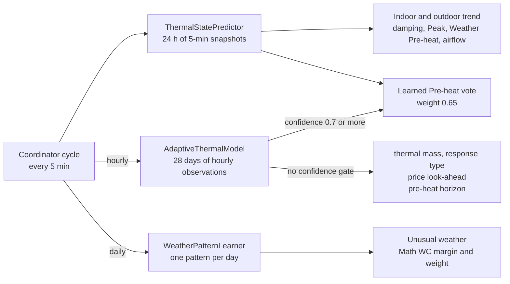

# Learning

Three learners record data on every control cycle. Little of what they learn steers the pump, and
what does is listed here. The learned pre-heat is on the open-findings register
([docs/agent/PROJECT_NOTES.md](../agent/PROJECT_NOTES.md)); check it before trusting or tuning it.

## The three learners

| Learner | Records | Produces | Reaches control |
|---|---|---|---|
| `AdaptiveThermalModel` (`adaptive_learning.py`) | indoor, outdoor and offset once an hour (`LEARNING_OBSERVATION_INTERVAL_MINUTES`); rolling 672 = 28 days | thermal mass 0.5-2.0, response type, heat-loss index, heating efficiency, decay rate, confidence | thermal mass and response type, ungated; the rest only behind the gate |
| `ThermalStatePredictor` (`prediction_layer.py`) | indoor, outdoor, offset, flow, DM every cycle; 24 h window | indoor and outdoor trend; the `Learned Pre-heat` layer | trend: trend damping, the `Peak` layer's prediction, `Weather Pre-heat`, airflow. Pre-heat: weight 0.65 once 24 h of history and a forecast exist |
| `WeatherPatternLearner` (`weather_learning.py`) | one pattern per day from the first 24 forecast hours, keyed by month and week | typical weather for the date (the zone's seasonal defaults until data exists); `detect_unusual_weather` | unusual weather adds 0.5-1.5 °C to the `Math WC` safety margin and 0.15 to its weight ([10](10_adaptive_climate_zones.md)) |

## The confidence gate

`LEARNING_CONFIDENCE_THRESHOLD` = 0.7. `ThermalStatePredictor.predict_temperature` uses the
learned heating efficiency and decay rate only when the learned parameters carry that confidence;
below it, its own responsiveness estimate. Confidence (`_calculate_confidence`) is
0.4 × observations/672 + 0.4 × consistency of the heating rates + 0.2 × time span/7 days, and the
consistency term is 0 with ten or fewer heating samples or a mean rate under 0.1 °C/h.

Learning needs 96 hourly observations (`LEARNING_MIN_OBSERVATIONS`, 4 days) before it produces
anything, and 192 with offset steps above 1 °C before it classifies the response type.

## What bypasses the gate

`__init__.py` hands the engine the `AdaptiveThermalModel` as its thermal model, set to the owner's
thermal mass and insulation. Every cycle the prediction layer calls
`thermal_model.get_parameters()`, which is `update_learned_parameters()`: once 96 observations
exist it overwrites `thermal_mass` and `ufh_type` on the model, whatever the confidence. From
there:

- `thermal_mass` sets the `Spot Price` look-ahead (`PRICE_FORECAST_BASE_HORIZON` 5 h × thermal
  mass) and scales the predictor's fallback temperature model. The DM thermal-mass buffer does not
  follow it: `heating_type` is fixed from the configured thermal mass when the engine starts.
- `ufh_type` sets `get_prediction_horizon()`: 48 h slow, 12 h medium or unknown, 6 h fast. The
  `Learned Pre-heat` layer reads that many forecast hours and looks half of them ahead. The
  `Weather Pre-heat` horizon is fixed when the engine starts and does not follow it.

The heat-loss index never reaches control: `calculate_preheating_target` uses
`DEFAULT_HEAT_LOSS_COEFFICIENT`, because the learned value is a relative index, not W/°C.

## Storage

`Store(hass, 1, "effektguard_learned_data")`: saved at most hourly when something changed, the
predictor every 5 minutes, and on shutdown. Keys: `version`, `last_updated`, `last_offset`,
`thermal_model` (`thermal_mass`, `ufh_type`, `learned_parameters`, `observation_count`),
`thermal_predictor`, `weather_patterns`, `weather_summary`, `dhw_state`.

A restart restores `ufh_type`, the predictor's snapshots and the weather patterns; the thermal mass
starts again from the owner's setting.
The hourly observations themselves are not saved: the window starts empty, and the model does not
re-learn until it has run another 4 days.
