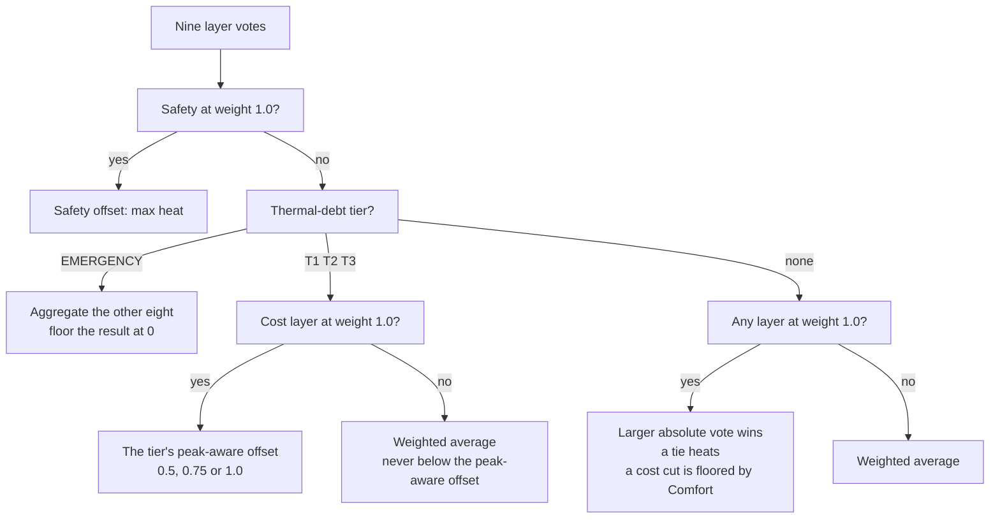

# Layer aggregation

How `DecisionEngine.calculate_decision` (`optimization/decision_engine.py`) turns nine layer votes
into the one offset the coordinator writes. Each layer returns a `LayerDecision` with a name, an
offset in °C, a weight and a reason; the name is the attribute the reasoning sensor publishes
([SENSOR_STATE_LIMITS.md](../SENSOR_STATE_LIMITS.md)). A manual override skips all of this
([07](07_manual_override_services.md)).

## The nine layers

| Name in the sensor | Module | Weight |
|---|---|---|
| `Safety` | `decision_engine.py` `_safety_layer` | 1.0 with +10 °C when indoor < 18 °C (`MIN_TEMP_LIMIT`); 0 otherwise; abstains without a room sensor |
| `Thermal Debt`, `T1`, `T2`, `T3`, `Anti-windup`, `Anti-windup Cooldown` | `thermal_layer.py` `EmergencyLayer` | by tier, table below |
| `Proactive` | `thermal_layer.py` `ProactiveLayer` | Z1-Z5: 0.3, 0.4, 0.5, 0.55, 0.6 |
| `Peak` | `effect_layer.py` `EffectManager` | 1.0 at the monthly peak (offset -3); 0.85 predictive (-1.5); 0.75 / 0.65 warning (-1.0 / -0.5); else 0 |
| `Learned Pre-heat` | `prediction_layer.py` | 0.65 when it votes (`LAYER_WEIGHT_PREDICTION`), see [06](06_learning_integration.md) |
| `Math WC` | `weather_layer.py` `WeatherCompensationLayer` | 0.50-0.95 by outdoor temperature × 0.49, reduced under thermal debt ([10](10_adaptive_climate_zones.md)) |
| `Weather Pre-heat` | `weather_layer.py` `WeatherPredictionLayer` | 0.85 × thermal mass, capped at 0.99 |
| `Spot Price` | `price_layer.py` `PriceAnalyzer` | 0.8 (`LAYER_WEIGHT_PRICE`); 1.0 in a PEAK quarter or PEAK cluster; × 0.3 while prices are volatile |
| `Comfort` | `comfort_layer.py` | 0.2 × the mode multiplier inside the band; ramps to 1.0 at 1.5 °C above target; 0.5 below the band |

`Spot Price` and `Peak` are flagged `is_cost_layer`; the cascade treats them differently.

### Thermal-debt tiers

`EmergencyLayer.evaluate_layer` returns a tier with its offset and weight. The thresholds are the
climate-aware ones from [10](10_adaptive_climate_zones.md).

| Tier | When | Offset | Weight |
|---|---|---|---|
| `EMERGENCY` | DM at or past -1500 (`DM_THRESHOLD_AUX_LIMIT`) and the room not more than 0.4 × tolerance above target | none of its own: the other layers decide, floored at 0 | 1.0 |
| `T3` / `T2` / `T1` | DM past the warning threshold by 400 / 200 / 0 (T3 capped at -1450) | 8.5 / 7.0 / 4.0, damped as the room recovers to no less than 2.0 / 1.5 / 1.0 | 0.91 / 0.81 / 0.65 |
| `ANTI_WINDUP`, `COOLDOWN` | DM falling 50 DM/h or faster within 90 min of our own raise | holds the offset; cuts it by abs(rate)/100 °C when the fall is past 100 DM/h; no raise for 30 min | 0.7 |
| `OK` | otherwise, including a room more than 0.4 × tolerance above target | 0 | 0 |

Tier weights are multiplied by 0.3 while prices are volatile. There is no WARNING or CAUTION tier.

## The cascade

`_aggregate_layers` is an ordered cascade, not a vote. Its invariant: a cost layer never reduces
heating while thermal-debt recovery is running.



1. **Safety** at weight 1.0 returns its offset. Nothing else is consulted.
2. **EMERGENCY tier**: the other eight layers are aggregated by these same rules and the result is
   floored at 0. No cuts, and no raise of its own: the compressor is flat out, so a raise only buys
   immersion heat.
3. **T1 / T2 / T3**: with a cost layer at weight 1.0 the result is the tier's peak-aware offset
   (`DM_CRITICAL_PEAK_AWARE_OFFSETS`: 0.5 / 0.75 / 1.0). Otherwise the weighted average of all
   layers, never below that offset. The tier is read from the decision, never inferred from a
   weight or an offset: damping changes the offset, and a weight is a tuning knob.
4. **Other critical layers** (`Peak` at the monthly peak, `Spot Price` in a PEAK quarter, `Comfort`
   at a full overshoot): the vote with the larger absolute offset wins; on an exact tie the heating
   vote wins (`>=`). When every critical layer is a cost layer and the room is below its comfort
   band, the cut is pulled toward the `Comfort` layer's own offset in proportion to how far out the
   room is (`_starvation_fraction`: 0 at target - 0.4 × tolerance, 1 at target - tolerance). A cost
   layer may coast the house within its band, not out of it.
5. **Everything else**: Σ offset × weight / Σ weight.

## After the cascade

Still inside `calculate_decision`, in this order:

- Trend damping: a raise is × 0.75 while the room warms at 0.3 °C/h or more, and × 1.15 while it
  cools at 0.3 °C/h or more (only below +3 °C); a cut is × 0.75 while the room cools fast.
- Compressor wear guard (`_limit_for_compressor_wear`): when the compressor is at its maximum
  frequency, a raise is withheld for a room at the top of its band or above, half of it passes at
  the target, all of it at the bottom of the band or while the room is cooling. Below 18 °C
  everything passes.
- Clamp to -10..+10 (`_clamp_offset`).

The coordinator then applies the offset volatility gate
([01](01_normal_optimization_cycle.md)) and writes whole degrees only (`utils/offset.py`).

## Worked example

Normal day, no critical layer, Safety / Thermal Debt / Proactive / Peak all at weight 0:

```
Learned Pre-heat  +1.0 × 0.65 = +0.65
Math WC           +0.5 × 0.42 = +0.21
Weather Pre-heat   0.0 × 0.00
Spot Price        -1.5 × 0.80 = -1.20
Comfort           -0.2 × 0.20 = -0.04
Sum of weights 2.07, weighted sum -0.38, offset -0.18 °C: inside the 1 °C deadband, no write
```
