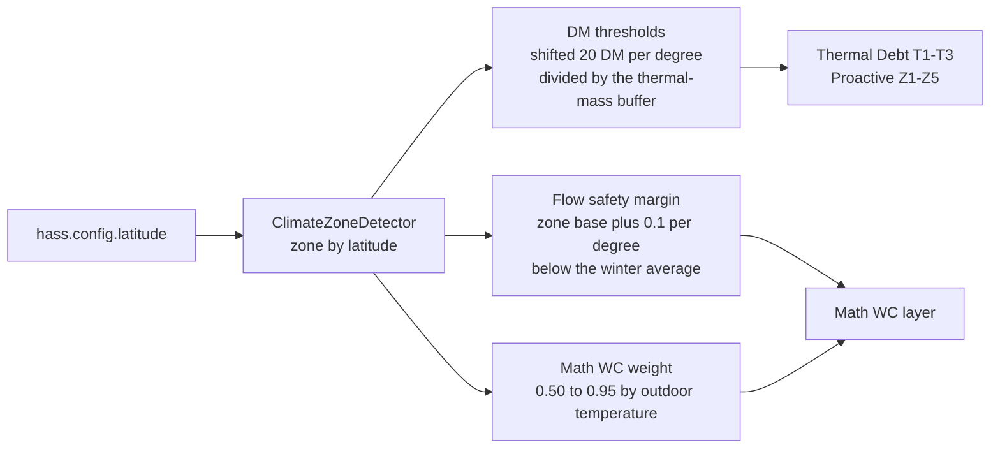

# Climate zones: the mechanism

Home Assistant's latitude picks a climate zone; the zone and the current outdoor temperature then
set the degree-minute thresholds, the flow-temperature safety margin and the weight of the weather
compensation layer. Nothing is configured. The DM tables per zone are in
[CLIMATE_ZONES.md](../CLIMATE_ZONES.md); this page is how they are made.

## Zone detection

`__init__.py` puts `hass.config.latitude` into the engine's config; `DecisionEngine` falls back to
59.33 (Stockholm) if it is missing. `ClimateZoneDetector` (`optimization/climate_zones.py`) takes
the absolute value, so the southern hemisphere is treated like the northern, and walks `ZONE_ORDER`
from coldest to mildest, first match wins:

| Zone | Latitude | Base safety margin |
|---|---|---|
| Extreme Cold | 66.5° - 90° | 2.5 °C |
| Very Cold | 60.5° - 66.5° | 1.5 °C |
| Cold | 56.0° - 60.5° | 1.0 °C |
| Moderate Cold | 54.5° - 56.0° | 0.5 °C |
| Standard | 0° - 54.5° | 0 °C |

The ranges touch, so a latitude exactly on a boundary gets the colder zone. A latitude above 90°
falls to Standard with a warning in the log.

## What the zone drives

**Degree-minute thresholds** (`get_expected_dm_range(outdoor_temp)`): the zone's normal range and
warning threshold, shifted by (outdoor_temp − zone winter average) × 20 DM/°C, so colder than
average is deeper. The shift is clamped: never within 50 DM of the -1500 aux limit, and never
shallower than -110 DM, where NIBE's compressor cycles anyway. `apply_thermal_mass_buffer`
(`thermal_layer.py`) then divides the normal range and warning threshold by 1.3 for a concrete
slab, 1.15 for timber underfloor heating, 1.0 for radiators, so a slow house starts recovering
sooner. `EmergencyLayer` (T1-T3) and `ProactiveLayer` (Z1-Z5) read the result.

**Flow safety margin** (`AdaptiveClimateSystem.get_safety_margin`, `weather_layer.py`): the zone
base, plus 0.1 °C per degree the outdoor temperature is below the zone's winter average, plus
0.5-1.5 °C when the weather learner flags unusual weather (0.5 + severity, where "unusual" is 0.5
and "extreme" 1.0). The weather compensation layer treats it as a tolerance band above the flow
the emitters need: inside the band the curve is left alone, below it the curve is pulled up to the
required flow, above it down to the top of the band.

**Weather compensation weight** (`get_dynamic_weight`): 0.85 below the winter average, 0.75 up to
5 °C above it, 0.65 below +5 °C outdoor, 0.50 from +5 °C; +0.15 in unusual weather, capped at
0.95. Multiplied by `DEFAULT_WEATHER_COMPENSATION_WEIGHT` (0.49), then by 0.92 / 0.84 / 0.73 /
0.61 while degree minutes are below -150 / -200 / -300 / -400 (`WEATHER_COMP_DEFER_*`). The layer
votes with weight 0 while hot water runs and for 30 minutes after.

**Weather learner defaults**: `WeatherPatternLearner.get_seasonal_default` derives the typical
temperature for a month from the zone's winter average until it has recorded patterns of its own.

Example, computed with the code: Stockholm (Cold) at -12 °C outdoor gives a safety margin of
1.0 + 0.4 = 1.4 °C and a weight of 0.85 × 0.49 = 0.42.
