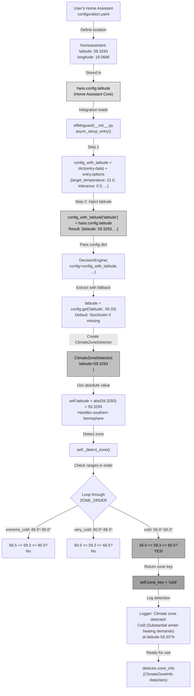
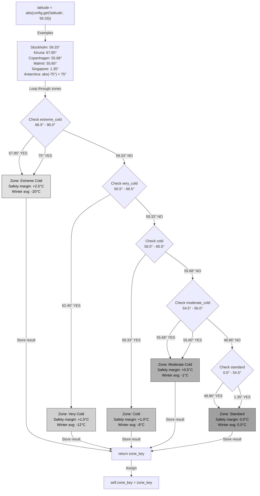
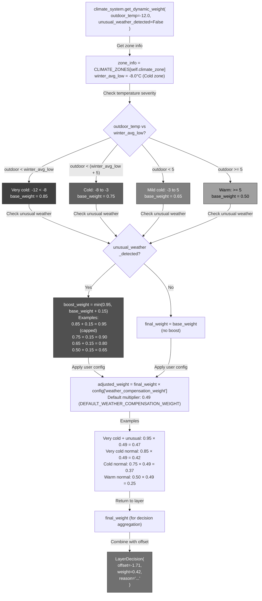

# Adaptive Climate Zone System Architecture

## Overview

Universal climate-based safety margin system that replaces Swedish-specific hardcoding with latitude-based automatic climate detection. Combines proven mathematical formulas with adaptive learning for global applicability.

# Adaptive Climate Zone System Architecture

## Overview

Universal climate-based safety margin system that replaces Swedish-specific hardcoding with latitude-based automatic climate detection. Combines proven mathematical formulas with adaptive learning for global applicability.

---

## Diagram 1: Latitude Source & Initialization Flow

**Shows exactly where latitude comes from and how it flows through the system.**



---

## Diagram 2: Climate Zone Detection Logic

**Shows the exact decision tree for zone detection with all edge cases.**



---

## Diagram 3: Runtime Safety Margin Calculation

**Shows exactly how safety margins are calculated during each optimization cycle.**

```mermaid
flowchart TD
    A["Coordinator Update (every 5 min)"] -->|Trigger| B["DecisionEngine.calculate_decision()"]
    
    B -->|Call layer 6| C["weather_comp_layer.evaluate_layer(nibe_state, weather_data, ...)"]
    
    C -->|Check config| D{self.enable_weather<br/>_compensation?}
    D -->|False| E1["Return LayerDecision:<br/>offset=0.0, weight=0.0<br/>reason='disabled'"]
    D -->|True| E2["Continue"]
    
    E2 -->|Extract data| F["outdoor_temp = nibe_state.outdoor_temp<br/>current_flow = nibe_state.flow_temp<br/>Example: Stockholm, concrete slab, -12°C, 38°C"]
    
    F -->|Calculate optimal| G["weather_comp.calculate_optimal_flow_temp()<br/>Uses the EN 442 emitter law"]
    G -->|Result| H["flow_calc.flow_temp = 34.0°C<br/>(the flow the emitters need)"]
    
    H -->|Check weather learner| I{self.weather_learner<br/>exists?}
    I -->|Yes| J["weather_learner.detect_unusual_weather(forecast)"]
    I -->|No| K["unusual_weather = False<br/>unusual_severity = 0.0"]
    
    J -->|Check result| L{is_unusual?}
    L -->|Yes| M["unusual_weather = True<br/>severity = 1.0 if 'extreme' else 0.5"]
    L -->|No| K
    
    K & M -->|Pass to climate system| N["climate_system.get_safety_margin(<br/>  outdoor_temp=-12.0,<br/>  unusual_weather_detected=False,<br/>  unusual_severity=0.0<br/>)"]
    
    N -->|Get zone info| O["zone_info = CLIMATE_ZONES[self.climate_zone]<br/>Example Cold zone:<br/>  base: 1.0°C<br/>  winter_avg_low: -8.0°C"]
    
    O -->|Calculate component 1| P["base_margin = zone_info['safety_margin_base']<br/>= 1.0°C"]
    
    O -->|Calculate component 2| Q{outdoor_temp < winter_avg_low?}
    Q -->|Yes: -12 < -8| R["temp_margin = (winter_avg_low - outdoor) × 0.1<br/>= (-8 - (-12)) × 0.1 = 0.4°C"]
    Q -->|No: outdoor >= winter_avg| S["temp_margin = 0.0°C"]
    
    R & S -->|Calculate component 3| T{unusual_weather_detected?}
    T -->|Yes| U["learning_margin = 0.5 + (unusual_severity × 1.0)<br/>Examples:<br/>  severity=0.5 → 1.0°C<br/>  severity=1.0 → 1.5°C"]
    T -->|No| V["learning_margin = 0.0°C"]
    
    U & V -->|Sum all components| W["total_margin = base + temp + learning<br/>Example: 1.0 + 0.4 + 0.0 = 1.4°C"]
    
    W -->|Return| X["safety_margin = 1.4°C"]
    
    X -->|A tolerance band, not an addition| Y["band = [required, required + margin] = [34.0, 35.4]°C<br/>current 38.0 is above it → adjusted_flow_temp = 35.4°C<br/>(inside the band: left alone; below: pulled up to required)"]
    
    Y -->|Calculate offset| Z["offset = (adjusted_flow - current_flow) / 1.5<br/>= (35.44 - 38.0) / 1.5 = -1.71°C<br/>(NIBE curve sensitivity: 1.5°C per offset)"]
    
    style P fill:#e0e0e0,stroke:#333,color:#000
    style R fill:#d0d0d0,stroke:#333,color:#000
    style U fill:#c0c0c0,stroke:#333,color:#000
    style W fill:#b0b0b0,stroke:#333,color:#000
    style Z fill:#a0a0a0,stroke:#333,color:#fff
```



---

## Diagram 4: Dynamic Weight Calculation

**Shows how layer weight adjusts based on temperature severity and unusual weather.**



---

## Diagram 5: Decision Aggregation

The weather compensation vote (the example's −1.71 °C at weight 0.42) is aggregated with the other
eight layers by the rules in [08_layer_priority_system.md](08_layer_priority_system.md): a layer with
weight ≥ 1.0 wins outright (a safety layer that is OK votes with weight 0), thermal debt acts by
tier, and otherwise the advisory layers are weight-averaged. The register then receives a whole
number of degrees (`utils/offset.py`: truncation plus a 1.0 °C deadband), never a fraction.

---

## Data Flow Detail

### 1. Latitude Source
```python
# Home Assistant Core Configuration (config/configuration.yaml)
homeassistant:
  name: Home
  latitude: 59.3293    # Stockholm, Sweden
  longitude: 18.0686
  elevation: 28
  unit_system: metric
  time_zone: Europe/Stockholm

# This becomes: hass.config.latitude = 59.3293
```

### 2. Integration Initialization (`__init__.py`)
```python
# Step 1: Merge entry.data (switch states) and entry.options (runtime settings)
config_with_latitude = dict(entry.data)
config_with_latitude.update(entry.options)
# entry.options = {
#     "target_temperature": 21.0,
#     "tolerance": 0.5,
#     "enable_price_optimization": True,
#     ...
# }

# Step 2: Inject latitude from Home Assistant global config
config_with_latitude["latitude"] = hass.config.latitude  # 59.3293

# Step 3: Pass to DecisionEngine
decision_engine = DecisionEngine(
    price_analyzer=price_analyzer,
    effect_manager=effect_manager,
    thermal_model=thermal_model,
    config=config_with_latitude,  # Now includes latitude!
    ...
)
```

### 3. DecisionEngine Initialization
```python
# Extract latitude with default fallback
latitude = config.get("latitude", 59.33)  # Default: Stockholm if missing

# Adaptive climate system (safety margin, dynamic weight) and the zone detector (DM thresholds)
self.climate_system = AdaptiveClimateSystem(latitude=latitude, weather_learner=weather_learner)
self.climate_detector = ClimateZoneDetector(latitude)

# Access zone info for calculations
zone_info = self.climate_detector.zone_info
# zone_info.dm_normal_min = -450
# zone_info.dm_normal_max = -700
# zone_info.dm_warning_threshold = -700
# zone_info.safety_margin_base = 1.0
```

### 4. ClimateZoneDetector Initialization
```python
# From climate_zones.py
detector = ClimateZoneDetector(latitude=59.33)

# Detection logic:
# 59.33° falls in range (56.0°, 60.5°) → "cold" zone
# Zone info:
#   name: "Cold"
#   description: "Substantial winter heating demands"
#   winter_avg_low: -8.0°C
#   safety_margin_base: 1.0°C
#   dm_normal_range: (-450, -700)
#   examples: ["Stockholm (SWE)", "Oslo (NOR)", "Göteborg (SWE)", "Helsinki (FIN)"]

_LOGGER.info(
    "Climate zone detected: Cold (Substantial winter heating demands) at latitude 59.33°N - "
    "Winter avg: -8.0°C, DM normal range: -450 to -700"
)
```

### 5. Runtime: Weather Compensation Layer

Computed with the code (`DecisionEngine.weather_comp_layer.evaluate_layer`), Stockholm (Cold zone), a
concrete slab (thermal mass 2.0), 21 °C target, −12 °C outdoor, current flow 38.0 °C, default weight:

```text
required flow (EN 442, design point)   34.0 °C
safety margin                          1.0 (zone base) + (-8 - (-12)) × 0.1 = 1.4 °C
tolerance band                         [34.0, 35.4] °C; 38.0 is above it → adjusted flow 35.4 °C
offset                                 (35.44 - 38.0) / 1.5 = -1.71 °C
weight                                 0.85 (colder than the zone's winter low) × 0.49 = 0.42

reason: "Math WC: en442_design_point; Zone: Cold; Optimal: 34.0°C; Safety: +1.4°C;
         Adjusted: 35.4°C; Current: 38.0°C → offset: -1.7°C; Weight: 0.42"
```

With the flow at 36.0 °C the same layer votes −0.38 °C; at 33.0 °C (below the band) +0.69 °C. Before
this, the layer skips a cycle while hot water runs, and keeps only part of its weight while the house
carries thermal debt (`WEATHER_COMP_DEFER_*`).

### 6. Decision Aggregation

See Diagram 5 and [08_layer_priority_system.md](08_layer_priority_system.md).

## Climate Zone Detection Logic

```python
def _detect_zone(self) -> str:
    """Detect climate zone based on latitude."""
    # Use absolute for hemisphere independence
    latitude = self.latitude  # Already abs() in __init__
    
    # Check from coldest to mildest (defined in ZONE_ORDER)
    for zone_key in ["extreme_cold", "very_cold", "cold", "moderate_cold", "standard"]:
        zone_data = HEATING_CLIMATE_ZONES[zone_key]
        lat_min, lat_max = zone_data["latitude_range"]
        
        if lat_min <= latitude <= lat_max:
            return zone_key
    
    # Fallback for edge cases
    return "standard"
```

## Real-World Examples

Computed with the code for radiators (thermal mass 1.0, the default), a 21 °C target and the default
weight 0.49. The safety margin defines a tolerance band above the required flow; the layer pulls a flow
below the band up to the required flow and one above it down to the band's top.

| | Kiruna 67.85°N, −35 °C | Stockholm 59.33°N, −10 °C | Copenhagen 55.68°N, +2 °C | Paris 48.86°N, +8 °C |
|---|---|---|---|---|
| Zone | extreme_cold | cold | moderate_cold | standard |
| Winter low | −20.0 °C | −8.0 °C | −1.0 °C | 0.0 °C |
| DM normal range | −800 to −1200 | −450 to −700 | −300 to −500 | −200 to −350 |
| Required flow (EN 442) | 61.8 °C | 46.8 °C | 38.6 °C | 33.9 °C |
| Safety margin | 2.5 + 1.5 = 4.0 °C | 1.0 + 0.2 = 1.2 °C | 0.5 °C | 0.0 °C |
| Band | 61.8-65.8 °C | 46.8-48.0 °C | 38.6-39.1 °C | 33.9 °C |
| Dynamic weight | 0.85 | 0.85 | 0.75 | 0.50 |
| Final weight (× 0.49) | 0.42 | 0.42 | 0.37 | 0.25 |

Kiruna's −35 °C lies past the default design outdoor temperature, so the emitter law extrapolates; the
offset the layer can vote is bounded by `WEATHER_COMP_MAX_OFFSET`.

## Configuration

### Automatic (No User Input)
- **Latitude**: From Home Assistant global config (`hass.config.latitude`)
- **Climate zone**: Automatically detected from latitude
- **Weather learner**: Automatically used if available (Phase 6)

### User-Configurable (Future - Phase 4 TODO)
- `enable_weather_compensation`: Boolean (default: True)
- `weather_compensation_weight`: 0.0-1.0 (default: 0.49, `DEFAULT_WEATHER_COMPENSATION_WEIGHT`)

### Advanced (Config file / learning)
- `heat_loss_coefficient`: W/°C (learned or user-provided)
- `radiator_rated_output`: Watts (optional: anchors the emitter law on the radiators' rated output)
- `heating_type`: "radiator", "concrete_ufh", "timber" (from thermal mass: the EN 442 / EN 1264 exponent
  and the design flow)

## Key Benefits

1. **Zero Configuration**: Uses HA latitude automatically
2. **Global Coverage**: Arctic to Mediterranean with same code
3. **Adaptive**: Combines zones + current temp + unusual weather
4. **Safe**: Progressive margins scale with cold severity
5. **Testable**: Clear inputs/outputs, 35 tests (`tests/unit/climate/test_adaptive_climate_zones.py`)
6. **Maintainable**: No country-specific conditionals

## Technical Notes

### Edge Cases & Fallback Behavior

**Tested with 35 comprehensive tests including 9 edge case scenarios.**

#### 1. Equatorial Locations (< 54.5°N)
```python
# Example: Singapore (1.35°N), Paris (48.86°N)
latitude = 48.86
# Result: Falls in "standard" zone (0.0°-54.5°)
# Rationale: Standard zone covers all mild climates globally
```

#### 2. Southern Hemisphere (Negative Latitude)
```python
# Example: Melbourne (-37.81°S), Sydney (-33.87°S)
latitude = -37.81
self.latitude = abs(latitude)  # Convert to 37.81°
# Result: 37.81° → "standard" zone (0.0°-54.5°)
# Rationale: Climate zones symmetric around equator for heating purposes
```

#### 3. Antarctica (Far South)
```python
# Example: McMurdo Station (-77.85°S)
latitude = -77.85
self.latitude = abs(latitude)  # Convert to 77.85°
# Result: 77.85° → "extreme_cold" zone (66.5°-90.0°)
# Rationale: CORRECT! Antarctic bases need same heating as Arctic
```

#### 4. Boundary Cases (Exactly at Zone Transition)
```python
# Arctic Circle (66.5°N) - exactly at boundary
latitude = 66.5
# Logic: if 66.5 <= latitude <= 90.0 → TRUE
# Result: "extreme_cold" zone (inclusive lower bound)

# very_cold/cold boundary (60.5°N)
latitude = 60.5
# very_cold: if 60.5 <= latitude <= 66.5 → TRUE (matches first)
# Result: "very_cold" zone

# cold/moderate_cold boundary (56.0°N)
latitude = 56.0
# cold: if 56.0 <= latitude <= 60.5 → TRUE (matches first)
# Result: "cold" zone

# moderate_cold/standard boundary (54.5°N)
latitude = 54.5
# moderate_cold: if 54.5 <= latitude <= 56.0 → TRUE (matches first)
# Result: "moderate_cold" zone
```

#### 5. Invalid Latitudes (> 90° or very unusual)
```python
# Example: Invalid input > 90° (should never happen)
latitude = 95.0
# Falls through all zone checks
# Result: Defaults to "standard" with warning
# Rationale: Safe fallback, prevents crashes
```

#### 6. Zero Latitude (Equator)
```python
latitude = 0.0
# Falls in standard zone (0.0°-54.5°)
# Result: "standard" zone
```

#### 7. Between Zones (No Gaps)
```python
# Zones are contiguous - all latitudes from 0° to 90° covered:
# extreme_cold:  66.5 - 90.0  (23.5° range)
# very_cold:     60.5 - 66.5  (6.0° range)
# cold:          56.0 - 60.5  (4.5° range)
# moderate_cold: 54.5 - 56.0  (1.5° range)
# standard:      0.0 - 54.5   (54.5° range)
# Total:         0.0 - 90.0   (90° range, no gaps)

# Example: 57.5° (middle of cold zone)
latitude = 57.5
# cold: if 56.0 <= 57.5 <= 60.5 → TRUE
# Result: "cold" zone (clean match, no ambiguity)
```

### Zone Range Overlaps (NONE - Clean Boundaries)

**All zone boundaries are inclusive on lower bound, exclusive on upper (except the topmost).**

```python
"extreme_cold": {
    "latitude_range": (66.5, 90.0),  # Includes 66.5°
},
"very_cold": {
    "latitude_range": (60.5, 66.5),  # 60.5° to 66.4999...°
},
"cold": {
    "latitude_range": (56.0, 60.5),  # 56.0° to 60.4999...°
},
"moderate_cold": {
    "latitude_range": (54.5, 56.0),  # 54.5° to 55.9999...°
},
"standard": {
    "latitude_range": (0.0, 54.5),   # 0° to 54.4999...°
},
```

**Result:** 54.5° → "moderate_cold", 56.0° → "cold" (first match wins in ZONE_ORDER)

### Why Absolute Latitude?
```python
self.latitude = abs(latitude)  # Handle southern hemisphere
```
Melbourne (-37.81°S) → abs(-37.81) = 37.81° → standard zone (same as southern France)

This works because climate zones are symmetric around equator for heat pump purposes. A location at 40°S has similar heating needs to 40°N.

### Why Default to Stockholm (59.33°N)?
Safe fallback if `hass.config.latitude` is somehow missing. Cold zone provides moderate safety margins suitable for most European deployments.

### Why Cap Dynamic Weight at 0.95?
Leave headroom for emergency/safety layers to override. Weather compensation is important but not more critical than preventing thermal debt or protecting from effect tariff peaks.

## Integration Points

- **Input**: `hass.config.latitude` (set during HA initial setup)
- **Output**: Safety margin (°C) and dynamic weight (0.0-1.0) for decision layer
- **Dependencies**: Optional weather_learner (Phase 6) for unusual weather detection
- **Side effects**: None (pure calculation, no state modification)

---

⚠️ **The flow temperatures above are computed by `utils/emitter.py` (the EN 442 emitter law), not by
"the Kühne formula" this document used to name.** That model was removed (audit F-119/F-121): it was
fed a heat-loss coefficient where the derivation requires a dimensionless relative load, so a
dimensionally inconsistent input went into a structurally correct law and produced numbers that
looked plausible and were not. It drove the flow temperature of a real heat pump.

The law is pinned to OpenEnergyMonitor's published weather-compensation tool
(`tests/validation/test_emitter_law_matches_openenergymonitor.py`). NIBE's own curve 9 is a straight line
and cannot validate it - see `docs/research/02_emitter_law.md`.
